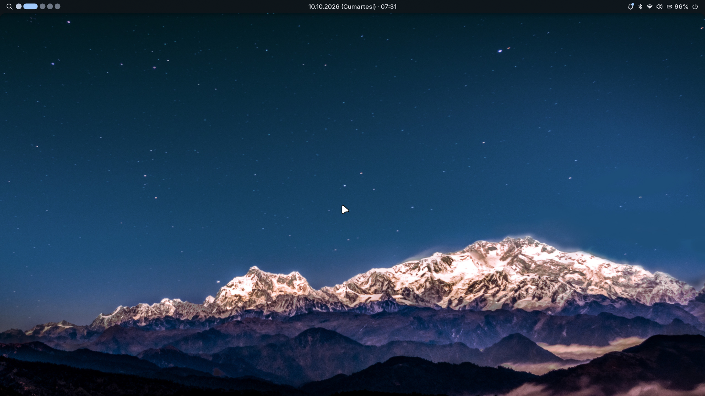

# Hyprland Dotfiles · CachyOS + Hyprland + Noctalia

> **EN —** My daily Linux desktop: CachyOS with the Hyprland tiling compositor (modular Lua config),
> the Noctalia shell for the panel, launcher and lock screen, and a matching GTK / Kitty / Alacritty theme.
> One script installs it with a backup of your current config; a second, interactive script applies the
> root-level fixes — including a boot-time black-screen fix for AMD + NVIDIA hybrid laptops.
> Built and tested on **CachyOS + Hyprland** only — install CachyOS with the Hyprland desktop first
> (see *Başlamadan önce* below).

Günlük kullandığım Linux masaüstü. Yeni bir makinede aynı düzeni dakikalar içinde kurmak için yazıldı:
tek komutla kurulur, mevcut ayarlarının yedeğini alır, istersen geri alınır.



<sub>Görüntüdeki duvar kağıdı repoya dahil değildir.</sub>

## Başlamadan önce — hangi sistem için?

Bu ayarlar **CachyOS + Hyprland** üzerinde hazırlandı ve yalnız orada denendi. En sorunsuz yol:

1. **CachyOS'u indir:** [cachyos.org/download](https://cachyos.org/download/) · kurulum rehberi:
   [CachyOS Wiki](https://wiki.cachyos.org/installation/installation_prepare/)
2. **Kurulumda masaüstü olarak Hyprland'ı seç.** Sonraki ek paketler ekranında Noctalia paketi
   işaretli gelirse bırak — bu ayarlar zaten Noctalia kullanıyor.
3. Kurulum bitince aşağıdaki [Kurulum](#kurulum) adımlarıyla bu ayarları uygula.

**Başka dağıtımlarda:**

| Dağıtım | Durum |
|---|---|
| CachyOS | ✅ Hazırlandığı ve denendiği sistem |
| Arch ve Arch tabanlılar (EndeavourOS vb.) | 🟡 Büyük ihtimalle çalışır — paketler aynı depolarda, ama denenmedi |
| Ubuntu, Fedora, Debian, openSUSE… | 🔴 Olduğu gibi çalışmaz — `pacman` / `paru` yok, paket adları farklı |

- Yapılandırma Hyprland'ın **Lua** biçiminde (`hyprland.lua`), Hyprland 0.56 ile denendi. Lua
  yapılandırmasını desteklemeyen eski bir Hyprland bu dosyaları okuyamaz.
- Arch ailesi dışında denemek istersen: Hyprland ve Noctalia'yı kendi dağıtımının yoluyla kur, sonra
  yalnız `kur.sh`'yi çalıştır. `sistem/sistem-kur.sh` Arch'a özel araçlar kullanır (`mkinitcpio`,
  Limine) — orada **çalıştırma**.

## Öne çıkanlar

- **Modüler Hyprland yapılandırması** — `hyprland.lua` yalnızca modülleri çağırır; kısayollar, ekran,
  görünüm, pencere kuralları ve masaüstleri ayrı dosyalarda.
- **Noctalia kabuğu** — panel, uygulama menüsü, duvar kağıdı döngüsü (geçiş efektleriyle), kilit ekranı,
  takvimde Türkiye resmî tatilleri.
- **Tutarlı tema** — GTK 3/4, Kitty ve Alacritty aynı Noctalia paletini kullanır; palet sabit, duvar kağıdı
  değişince renkler kaymaz.
- **Klavyeyle her şey** — 5 masaüstü, pencere taşıma/boyutlandırma, pano geçmişi, alan seçip ekran görüntüsü,
  `Super + O` ile anlık pencere saydamlığı (küçük bir kabuk betiği).
- **Türkçe klavye öncelikli** — `tr,us`, `Alt + Shift` ile geçiş.
- **Güvenli kurulum** — `kur.sh` üzerine yazmadan önce yedek alır; `sistem-kur.sh` her adımı tek tek sorar.

## Kurulum

**Gerekli paketler (Arch / CachyOS):**

```bash
sudo pacman -S --needed hyprland kitty alacritty dolphin firefox vlc mpv \
  greetd gnome-keyring plymouth noctalia noctalia-greeter github-cli paru
paru -S --needed google-chrome whitesur-icon-theme
```

**Ayarlar:**

```bash
git clone https://github.com/emirdnz/hyprland-dotfiles.git
cd hyprland-dotfiles
bash kur.sh                      # kullanıcı ayarları (~/.config) — önce yedek alır
sudo bash sistem/sistem-kur.sh   # isteğe bağlı: sistem ayarları — her adımı sorar
```

`kur.sh` mevcut ayarlarını `~/.config-yedek-<tarih>` altına yedekler; geri alma komutunu da
kurulumun sonunda yazar. Duvar kağıtları repoda yok — kendi `.jpg` dosyalarını `duvar-kagitlari/`
klasörüne koyarsan kurulum onları `~/Pictures/Wallpapers` altına kopyalar.

## Ne var içinde

```
config/
├── hypr/            Hyprland — hyprland.lua + config/*.lua modülleri, saydamlık betiği
├── noctalia/        panel, tema, duvar kağıdı döngüsü, kilit ekranı, takvim
├── kitty/           terminal + tema
├── alacritty/       terminal + tema
├── gtk-3.0/         GTK 3 tema ve ikon ayarları
├── gtk-4.0/         GTK 4 tema ve ikon ayarları
└── uwsm/env         oturum değişkenleri (tarayıcı, imleç, Qt)
sistem/sistem-kur.sh root gerektiren ayarlar (açılış ekranı, giriş ekranı, klavye, anahtarlık)
kur.sh               kullanıcı ayarlarını kurar
NOTLAR.md            her ayarın gerekçesi ve bilinen tuzaklar
```

## Kısayollar

`Super` = Windows tuşu.

| Tuş | Ne yapar |
|---|---|
| `Super + Enter` | Terminal (Kitty) |
| `Super + B` / `Super + G` | Firefox / Chrome |
| `Super + E` | Dosya yöneticisi |
| `Super + Space` | Uygulama menüsü |
| `Super + Q` | Pencereyi kapat |
| `Super + F` | Tam ekran |
| `Super + 1..5` | Masaüstüne git (5 masaüstü) |
| `Super + Shift + 1..5` | Pencereyi o masaüstüne taşı |
| `Super + Ok` | Pencereler arası geç |
| `Super + Shift + Ok` | Pencereyi taşı |
| `Super + Alt + Ok` | Pencereyi boyutlandır |
| `Super + Alt + Space` | Pencereyi serbest (yüzer) yap |
| `Super + O` / `Super + Shift + O` | Pencere saydamlığını azalt / artır |
| `Super + Alt + O` | Saydamlığı varsayılana döndür (%95) |
| `Super + W` | Duvar kağıdı paneli |
| `Super + Shift + W` | Rastgele duvar kağıdı |
| `Super + V` | Pano geçmişi |
| `Super + L` | Ekranı kilitle |
| `Print` | Alan seçip ekran görüntüsü |
| `Alt + Shift` | Klavye dili (TR ↔ EN) |

## Çözülen sorun: hibrit ekran kartlı laptopta siyah açılış

AMD iGPU (panele bağlı) + NVIDIA dGPU (panele bağlı değil) olan bir laptopta açılış üç ayrı yerden
bozuluyordu. Her birinin sebebi ayrı bulundu ve `sistem-kur.sh` içinde isteğe bağlı bir adım olarak çözüldü:

| Belirti | Sebep | Çözüm |
|---|---|---|
| Açılışta 15 sn siyah ekran, logo yok | Plymouth `simpledrm`'e çizmiyor; AMD sürücüsü geç yükleniyor | Çekirdek satırına `plymouth.use-simpledrm` |
| Logo gelip kayboluyor | Ekran kartı devir teslimi (simpledrm → amdgpu) | `MODULES=(amdgpu)` ile erken KMS |
| Giriş ekranı siyah | Greeter, AMD kartı meşgulken panele bağlı olmayan NVIDIA'ya düşüyor | greetd → `After=plymouth-quit.service` |

Denenip **bırakılan** yollar ve kurtarma sırası (LTS çekirdeği → snapshot → bağlayıp düzeltme)
[`NOTLAR.md`](NOTLAR.md) içinde.

## Makineye özel — kendi makinende kontrol et

Ayarlar 1920×1080 ekranlı, AMD + NVIDIA hibrit bir laptopa göre yapıldı.

- `config/hypr/config/monitors.lua` → ekran ölçeği (`scale = "1.2"`) ve çözünürlük
- `config/uwsm/env` → imleç teması, varsayılan tarayıcı
- `sistem/sistem-kur.sh` → 2. adım (erken KMS) yalnız hibrit ekran kartlı makineler için; değilse "h" de, geç

## Lisans

[MIT](LICENSE)

---

Geliştirici: [Emir Engin Deniz](https://github.com/emirdnz)
